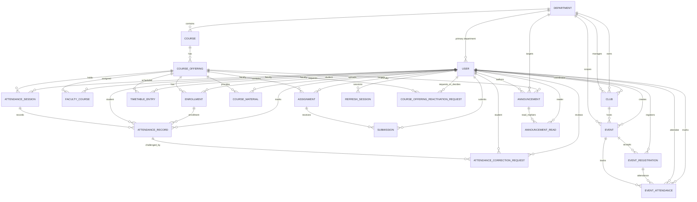

# CampusConnect — Database ERD and Data Dictionary

## 1. Entity relationship diagram

The diagram focuses on persisted domain relationships. `User` is referenced by many workflow records; the diagram groups those links to remain readable. MongoDB references are ObjectId references, not SQL foreign-key constraints. The services validate relationships and scope.

## 2. Collections and responsibilities

| Model / collection | Purpose | Main relationships |
|---|---|---|
| `User` | Identity, role, account status, password hash | Optional/required department by role |
| `Department` | Academic department | Courses, students/coordinators, clubs, scoped events/notices |
| `Course` | Department-owned course catalogue entry | Department |
| `CourseOffering` | A course delivered for academic year, semester, and section | Course |
| `FacultyCourse` | Faculty assignment to an offering | User (faculty), CourseOffering |
| `Enrollment` | Student enrollment in an offering | User (student), CourseOffering |
| `TimetableEntry` | Scheduled class slot and room | CourseOffering, User (faculty) |
| `Assignment` | Faculty-created work and deadline | CourseOffering, User (faculty) |
| `Submission` | Student submission, versions/files, evaluation | Assignment, User (student) |
| `CourseMaterial` | Private course resource metadata | CourseOffering, User (uploader) |
| `AttendanceSession` | A class meeting attendance session | CourseOffering, User (faculty), optional timetable entry |
| `AttendanceRecord` | One student's attendance result for a session | Session, User (student), Enrollment |
| `AttendanceCorrectionRequest` | Student request to correct an attendance record | AttendanceRecord, User (student), optional reviewer |
| `Announcement` | Institution/department/course-scoped notice | User (author), optional Department/CourseOffering |
| `AnnouncementRead` | Per-student read marker | Announcement, User (student) |
| `Club` | Department-associated club and coordinator | Department, User (coordinator/creator) |
| `Event` | Club/department campus event and lifecycle | Club, Department, creator User |
| `EventRegistration` | Student registration and registration status | Event, User (student) |
| `EventAttendance` | Attendance outcome for event participants | Event, EventRegistration, User |
| `RefreshSession` | Refresh-token session and revocation family | User |
| `CourseOfferingReactivationRequest` | Request/decision history for reactivating an offering | CourseOffering, requester/decider User |

## 3. Relationship notes

- A course is a catalogue concept; a course offering is a specific delivery instance. Enrollment, faculty assignment, timetable, assignment, course material, and attendance attach to the offering rather than directly to the catalogue course.
- `FacultyCourse` is an assignment relationship, not an embedded faculty list. It supports multiple faculty assignments per offering where the service permits them.
- Attendance records are tied to both the session and the student's enrollment. This allows the service to validate that the student belongs to the offering for which attendance is being marked.
- Submissions are tied to an assignment and a student. File metadata refers to private object storage; the binary file is not stored in MongoDB.
- Announcement read tracking is a separate collection so each student has an independent read state.
- Event registration and event attendance are separate. Registration expresses intent/eligibility; attendance records the later participation outcome.
- Refresh sessions are security/session records, not academic records.

## 4. Important uniqueness and query indexes

The model definitions are authoritative. The following are the principal declared indexes worth knowing during maintenance:

| Model | Index intent |
|---|---|
| User | Unique email; role/status; department/role/status |
| Department | Department code; active department/name |
| Course | Department/code; department/active/name |
| CourseOffering | Academic year/semester/active filters |
| FacultyCourse | Offering/active and faculty/active lookups |
| Enrollment | Student/status and offering/status lookups |
| TimetableEntry | Offering/day/time, faculty/day/time/active, room/day/time/active |
| Assignment | Offering/status/deadline and faculty/status/created date |
| CourseMaterial | Offering/created date and uploader/created date |
| AttendanceSession | Faculty/date and offering/date/status |
| AttendanceRecord | Student/created date and enrollment/session |
| AttendanceCorrectionRequest | Student/created date and reviewer/status |
| Announcement | Scope/published date, department or offering scoped feeds, expiry |
| AnnouncementRead | Student/read date |
| Club | Active/category/name and department/active/name |
| Event | Status/start date, department or club scoped status/start date, creator/date |
| EventRegistration | Student/status/date and event/status/date |
| EventAttendance | Event/status and student/date |
| RefreshSession | User/revocation and token-family/revocation |
| CourseOfferingReactivationRequest | Status/date and offering/date |

Do not infer that a compound index enforces uniqueness unless the model declares `unique: true` or an equivalent unique index. For example, the attendance and event workflow services also validate invariants at the application layer; inspect the current model source before changing those rules.

## 5. Data lifecycle and integrity

- Account status is represented by `isActive`; deactivation should not be confused with deleting historical academic records.
- Timetable entries support deactivation so historical schedule records remain available.
- Assignment publication and due dates are enforced by services, not by a MongoDB schema alone.
- Attendance is session-based. Bulk marking must be validated against the session's course offering and enrolled roster.
- Event lifecycle transitions (draft, published, cancelled, completed) are controlled by event services.
- File object keys and metadata must correspond to actual private-storage objects. Do not seed placeholder objects.
- MongoDB references do not automatically provide relational cascade deletes. Deletion/deactivation behavior must be explicitly implemented and reviewed in the relevant service.

## 6. How to update the ERD

When adding or changing a model:
1. Update the model file and its validation/indexes.
2. Update this diagram and the collection table.
3. Update `API-REFERENCE.md` if an endpoint or payload changes.
4. Regenerate/review `openapi.yaml` when the HTTP contract changes.
5. Include ownership, role, department, enrollment, and lifecycle checks in the implementation and tests.
