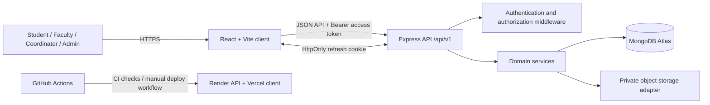

# CampusConnect — Technical Architecture

## 1. Product overview

CampusConnect is a role-based academic and campus-life portal. It brings together course delivery, timetable visibility, assignments and submissions, attendance, announcements, clubs, and events. It is a focused campus portal, not a full ERP.

The application has four account roles:

- **Student** — accesses their own academic records, course materials, assignments, submissions, attendance, announcements, and event registrations.
- **Faculty** — works with assigned course offerings, publishes assignments and announcements, shares course materials, records attendance, and evaluates submissions.
- **Coordinator** — performs department-scoped academic and campus coordination, including relevant course/timetable, club, and event workflows.
- **Admin** — manages institution-wide setup and privileged account/academic operations.

The server is the authority for identity, role checks, ownership, department/course scope, deadlines, enrollment, and lifecycle transitions. Hiding a button in React is not a security boundary.

## 2. System context and architecture



### Runtime responsibilities

| Layer | Responsibility |
|---|---|
| React client | Role-aware screens, routing, forms, query/cache state, accessible interactions |
| Vite | Local development server and optimized production asset build |
| Express | HTTP routing, middleware, request parsing, CORS, health endpoints, error handling |
| Authentication middleware | Validates the access token, reloads the active user, attaches `req.user` |
| Role middleware | Rejects roles not explicitly allowed by a route |
| Domain services | Enforce ownership, academic scope, enrollment, lifecycle, and business rules |
| Mongoose models | Define document shape, validation, references, timestamps, and indexes |
| MongoDB | Persistent application records |
| Storage service | Creates and completes private uploads and authorized temporary downloads |
| GitHub Actions | CI workflow and manually triggered production deployment workflow |

## 3. Repository map

```text
CampusConnect/
├── client/                 # React + Vite frontend
├── server/
│   ├── src/
│   │   ├── config/         # Environment and database configuration
│   │   ├── middleware/     # Authentication, role checks, security, errors
│   │   ├── models/         # Mongoose models
│   │   ├── routes/         # /api/v1 route modules
│   │   ├── scripts/        # Development seed script
│   │   ├── services/       # Domain/business logic
│   │   ├── utils/          # Shared server utilities
│   │   └── validation/     # Request validation
│   └── tests/              # Node test suites
├── docs/                   # Architecture, ERD, API reference, OpenAPI
├── .github/workflows/      # CI and manual deployment workflows
├── render.yaml             # Render service blueprint
└── README.md
```

## 4. Request lifecycle

1. The browser calls an API route under `/api/v1`.
2. Express applies security headers, request logging, CORS, JSON parsing, and cookie parsing.
3. Protected routes run `authenticate`. It reads `Authorization: Bearer <access-token>`, verifies the token, loads the corresponding user, and rejects missing, invalid, expired, or inactive identities.
4. `authorizeRoles(...)` performs the route-level role gate where one is declared.
5. Route validation checks path parameters, query parameters, and request bodies.
6. A domain service applies resource-level checks: ownership, department scope, assigned faculty, enrollment, deadline, status, or capacity.
7. Mongoose reads or writes MongoDB. File workflows delegate to the storage service.
8. The route returns JSON. Errors flow through the centralized not-found and error handlers.

A route-level role check is only one layer. For example, two faculty members may both have the `faculty` role, but a service must still verify that the requested course offering or assignment belongs to the current faculty member.

## 5. Authentication and session model

- Login returns an access token in the JSON response and sets a refresh token in an HttpOnly cookie.
- Protected API requests send the access token in the `Authorization: Bearer` header.
- Refresh and logout use the refresh cookie and trusted-origin checks.
- Refresh sessions are persisted and support revocation and token-family tracking.
- Login, refresh, and account provisioning have rate limits.
- Passwords are stored as bcrypt hashes; plaintext passwords must never be logged or committed.
- Account provisioning is administrator-only. Public self-registration is not the account-provisioning model.

The browser client must use credentialed requests for refresh-cookie operations. Keep access tokens short-lived and never expose refresh tokens to JavaScript.

## 6. Authorization model

Authorization is layered:

1. **Authentication:** Is this an active, valid user?
2. **Role authorization:** Is this role allowed to call the operation?
3. **Resource authorization:** Does this user own or have access to this exact record?
4. **Academic scope:** Does the resource belong to the user's department, assigned offering, or enrollment?
5. **Workflow validation:** Is the requested state transition currently legal?

Examples:

- Students can only access their own submissions and attendance.
- Faculty operations are constrained to assigned course offerings and owned work.
- Coordinators are constrained by department and coordinator-managed club/event scope.
- Administrators have institution-level privileges, but sensitive operations still pass validation and lifecycle rules.

## 7. Data and file handling

MongoDB stores metadata and relationships. Assignment submissions and course materials use private object storage; a browser should not receive a permanent public object URL. The API issues short-lived, authorized upload/download URLs and validates completion metadata before making a file available through application workflows.

Do not store storage credentials in source control. Configure them as deployment secrets or environment variables. A development seed does not create fake file objects.

## 8. API conventions

- Base path: `/api/v1`
- Content type: `application/json` for ordinary JSON requests.
- Success envelope: `{ "success": true, "data": ... }`; some mutations also return `message`.
- Errors are handled centrally and use an error response with a message/code where available.
- IDs are MongoDB ObjectIds in URL parameters.
- Upload flows use dedicated upload URL and completion endpoints rather than sending file bytes through the ordinary JSON body.
- See [API Reference](API-REFERENCE.md) and [OpenAPI description](openapi.yaml).

## 9. Health and deployment

| Endpoint | Meaning |
|---|---|
| `GET /api/v1/health` | Compatibility health response; process-level status |
| `GET /api/v1/health/live` | Liveness; confirms the process is alive |
| `GET /api/v1/health/ready` | Readiness; returns 503 when MongoDB is not connected |

The production layout uses a Vercel-hosted client and a Render-hosted API, with MongoDB Atlas and private object storage as external services. GitHub Actions contains CI and a separate manually triggered deployment workflow. Deployment is not considered verified merely because workflow files exist.

## 10. Development data

The development seed is intentionally opt-in. It requires `NODE_ENV=development` and `ALLOW_DEMO_SEED=true`. It reuses records safely and does not reset passwords or delete application data. Read `PHASE-57-IMPLEMENTATION-NOTES.md` before using it.

## 11. Operational and security rules

- Never commit `.env`, JWT secrets, database credentials, storage credentials, or deployment tokens.
- Use a dedicated test database for integration tests.
- Do not run seed scripts or test suites against production.
- Keep object storage private.
- Review role and resource scope together for every new endpoint.
- Add database indexes for real query patterns and uniqueness invariants.
- Run lint, unit/regression tests, production builds, bundle budgets, accessibility checks, and E2E flows during the planned final verification phase.
- Keep documentation synchronized with the route and model source; code is authoritative if a future change makes this document stale.

## 12. Known documentation boundaries

This document describes the repository architecture and implemented route families. It is not a deployment attestation, penetration-test report, SLA, or guarantee that external services are configured. Exact request-body schemas and all business-rule edge cases remain defined by the route validation modules and domain services.
